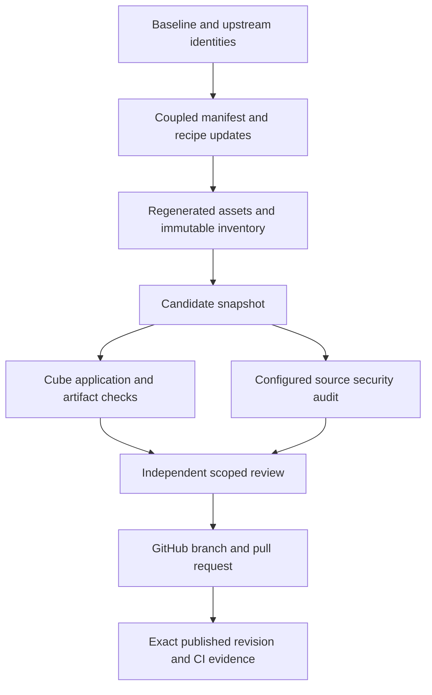

# Refresh ESF components and security evidence

## Goal Capsule

**Objective:** Operators can review and obtain an updated ESF candidate from GitHub, with reproducible dependency identities and evidence describing the security and compatibility checks it passed.

**Means:** Refresh supported upstream components, regenerate dependent artifacts, and verify the resulting candidate under KTD1–KTD4.

**Authority:** The user authorized component upgrades, security repairs, and publication to GitHub through the ESF compound workflow.
The primary checkout's unrelated changes are outside this candidate.

**Execution profile:** The host coordinates source edits, permitted builds, and factory driving; ESF application code, tests, linters, and package lifecycle scripts execute inside disposable local Cube microVMs.
The implementing agent finishes the candidate, obtains independent review, and publishes its branch and reviewable pull request.
An unresolved critical/high security defect or an unavailable required verification environment must remain explicit in the handoff rather than becoming a passing claim.

---

## Product Contract

### Summary

Audit every maintained component family, update versions and immutable artifacts where a compatible supported release exists, repair supported security findings, and push the reviewed candidate to GitHub.
Retain enough candidate-bound evidence to distinguish completed checks from unavailable or incomplete coverage.

### Problem Frame

ESF embeds several dependency ecosystems, downloadable agent binaries, generated browser assets, and deployment recipes.
A version-only change can leave the executed binary, embedded inventory, image digest, or generated asset behind; a green fixture run cannot establish those components' security or application behavior.

### Requirements

**Component freshness and reproducibility**

- R1. Account for Go modules/toolchain, the frontend, OpenCode, Pi, optional Claude/Codex CLIs, Unreal, Harness2 provenance, Python tools, build/runtime/service images, Temporal/PostgreSQL recipes, qualification tools, and GitHub Actions; record changed versions and justified retained pins.
- R2. Resolve upgrades from current authoritative upstream releases or registries and retain immutable checksums, package integrity values, lockfiles, and provenance for artifacts that ESF installs or embeds.
- R3. Keep release inventory, embedded inventory, installer/template recipes, examples, CI toolchains, generated Pi/catalog/notices, and generated frontend assets consistent with their owning manifests.

**Security and verification**

- R4. Run candidate-bound dependency, secret, and infrastructure source scans; investigate critical/high findings and repair actionable defects without suppressing unexplained results.
- R5. Exercise affected ESF suites and installation/artifact contracts inside local Cube; preserve the existing credential, egress, process isolation, and release qualification boundaries.
- R6. Collect a scoped independent review and address supported findings before publication; retain unavailable configured-model coverage explicitly.

**Delivery**

- R7. Push only this candidate to GitHub and retain the published revision, verification scope, review outcome, cleanup result, and material limitations.
Local tests, CI, AI review, eligible human approval, merge, deployment, and production acceptance remain separate evidence.

### Scope Boundaries

The candidate starts from baseline `804fb461068972a707628b0a3243e4db09cafb0c` on `codex/esf-component-security-upgrade-20261025`.
It excludes unrelated dirty primary-checkout work and local credentials/configuration.
Publication does not authorize replacing live infrastructure, migrating a live PostgreSQL cluster, merging the pull request, granting human approval, or declaring production qualification.
No new security provider, model fallback, or host-side project execution is introduced to bypass an unavailable environment.

---

## Planning Contract

### Component map

| Family | Owning source and affected contracts |
|---|---|
| Go and Cube SDK | `go.mod`, `go.sum`, `.mise.toml`, Cube adapter tests, Go toolchain pins in CI/build recipes |
| Browser application | `internal/controlplane/web/package.json`, its lockfile and tracked `dist/`, frontend tests |
| Native agent packages | `agents/opencode/package.json`, `agents/pi/package.json`, both lockfiles, `agents/pi/inventory.json`, Pi `dist/`, `internal/agentharness/pi-catalog.json` |
| Downloaded agents | `scripts/install-agents.sh`, `scripts/install-pi-agent.sh`, `deploy/cube/Dockerfile`, optional CLI identities in release inventory and examples |
| Python tools | `pyproject.toml`, `uv.lock`, `tools/intake/pyproject.toml`, `tools/brief_lab/pyproject.toml` |
| Services and images | `deploy/images/Dockerfile.*`, `deploy/cube/Dockerfile*`, `deployments/dev/temporal/docker-compose.yaml`, its `.env.example`, Helm recipes |
| Release and provenance | `release/inventory.json`, identical `internal/releaseinfo/inventory.json`, `third_party/harness2/UPSTREAM.json`, release qualification documents |
| Automation and scanners | `.github/workflows/*.yml`, `.github/dependabot.yml`, security-tool inventory pins |

### Key Technical Decisions

- KTD1. **One coherent inventory.** Treat manifests and immutable upstream artifacts as inputs and regenerate each dependent inventory/artifact, following `scripts/verify-release-inventory.py` and `scripts/verify-pi-inventory.py`.
  A supported pin may remain unchanged when it is already current or an upgrade lacks required compatibility evidence; R1 requires documenting that disposition.
- KTD2. **Verify the actual candidate.** Bind archives, binaries, scanner results, and Cube reports to source hashes or a committed revision.
  `factory run --local-path ... --rev ...` transfers committed objects, so dirty edits require an explicit candidate snapshot or an authorized commit before execution.
- KTD3. **Reuse configured security infrastructure.** Coordinate the existing OpenCode/OpenCyber source audit through `docs/continuous-security.md` from the configured source checkout when that workflow is not tracked at baseline.
  Scanner findings, model triage, and reproduced runtime defects have distinct coverage; an unavailable configured model remains incomplete.
- KTD4. **Preserve compatibility boundaries.** Upgrade coupled Temporal API/SDK and OpenTelemetry families coherently, rebuild generated artifacts with pinned tools, and preserve existing production-qualification gates.
  Updating PostgreSQL/Temporal recipes is separate from applying live migrations or declaring live replay acceptance.

### Assumptions and dependencies

“Upgrade all” means audit every maintained family and select the latest supported compatible stable candidate; it does not require adopting prereleases or blindly replacing vendored algorithms with upstream runtime code.
Exact selected versions, artifact digests, scan database timestamps, and remaining compatibility failures are implementation-time evidence and belong in the resulting qualification report.
Current upstream research is owned by the implementing agent and must precede its version edits.
The existing security watcher and its configuration may be supplied from the source checkout without publishing that checkout's unrelated changes.

Read the live selected `factory.toml` and standalone-tool `.env` rather than restoring example template IDs.
`docs/solutions/workflow-issues/local-cube-configuration.md` in the configured source checkout documents this drift and the limited meaning of fixture conformance.

### Verification flow

---

## Implementation Units

### U1. Resolve and update coupled dependency inputs

**Goal:** Refresh every maintained family under R1–R3.
**Dependencies:** None.
**Files:** The component-map manifests and recipes, `.mise.toml`, `Makefile`, `.github/workflows/*.yml`, `internal/factory/example.toml`, release inventories, relevant installer and verification scripts.
**Approach:** Research upstream versions, release notes, compatibility constraints, and immutable artifact identities; update coupled pins together under KTD1/KTD4.
Retain Harness2's explicit algorithm-integration and production-qualification boundaries when refreshing provenance.
**Execution note:** Prefer installation and artifact smoke verification for this packaging work; add focused regression tests only when an actual compatibility/security repair changes behavior.
**Test scenarios:**

- A changed manifest and its inventory/example/recipe references agree, while a deliberately stale dependent pin is rejected by the existing inventory verifier.
- Updated optional agents and runtime binaries match their recorded checksums and start successfully in Cube without exposing provider credentials.
- Temporal/PostgreSQL recipes retain explicit volume selection and restored-database safety checks.

**Verification:** Inventory checks, clean lockfile resolution, relevant existing adapter suites, and runtime/installation smoke checks pass for the candidate.

### U2. Regenerate embedded assets and record exact identities

**Goal:** Complete R2/R3 with artifacts reproducible from updated inputs.
**Dependencies:** U1.
**Files:** `agents/pi/dist/`, `agents/pi/inventory.json`, `internal/agentharness/pi-catalog.json`, `internal/controlplane/web/dist/`, release inventories, `scripts/verify-pi-inventory.py`, `scripts/generate-sbom.py`.
**Approach:** Rebuild Pi, export its catalog/notices, rebuild the frontend, and update hashes and template recipe identities under KTD1/KTD2.
**Test scenarios:**

- Rebuilding with the selected lockfiles reproduces checked-in Pi and frontend artifacts without additional tracked or untracked output changes.
- Pi runner/catalog/notices hashes and release/embedded inventories agree with their final source bytes.
- Generated SBOM identities correspond to the selected inventories and dependency graphs.

**Verification:** Existing artifact/inventory validators and clean generated-artifact comparisons pass inside Cube.

### U3. Validate compatibility and resolve security findings

**Goal:** Establish the evidence required by R4–R6.
**Dependencies:** U1, U2.
**Files:** Existing tests under `internal/`, `agents/pi/test/`, `internal/controlplane/web/src/*.test.js`, `scripts/tests/`, `tools/intake/tests/`, `tools/brief_lab/tests/`; new focused tests only alongside supported behavioral repairs.
**Approach:** Run the existing application and qualification suites inside Cube and coordinate candidate-bound OpenCyber/OpenCode scanning under KTD2/KTD3.
Triaging findings includes dependency reachability, exposed secrets, relevant image/configuration scope, and any required Cube reproduction.
**Test scenarios:**

- Go adapter/factory/control-plane suites preserve timeout, sandbox lifecycle, credential-redaction, and release gate behavior with updated dependencies.
- Frontend, Pi, and credential-free Python suites pass under their selected supported runtimes.
- Known malicious/invalid inputs remain rejected by the existing relevant security tests; each newly supported security fix has a regression reproducer.
- Scanner/model failure is retained as incomplete coverage, with owned Cube resources cleaned up on both success and failure.

**Verification:** Retain exact source identity, tool versions, scan scope/results, Cube reports, independent reviewer findings, and final sandbox count.

### U4. Publish reviewed candidate and bounded qualification evidence

**Goal:** Fulfill R7 with an auditable GitHub handoff.
**Dependencies:** U3.
**Files:** A dated component-upgrade qualification report under `release/qualification/`, evidence files justified for publication, and a reusable `docs/solutions/` entry only if verified non-obvious reasoning warrants one.
**Approach:** Summarize changed/retained components, completed checks, unresolved limits, and independent review; push the authorized branch and open a pull request with the concrete resulting behavior and validation.
Read back the remote revision and available matching-head CI state.
**Test expectation:** None for publication prose; verify the published tree/revision and artifact links directly.
**Verification:** Remote source matches the reviewed candidate and the report distinguishes pending checks from passes.

---

## Verification Contract

The following existing checks are verification targets inside Cube; they are not authorization to execute project tests on the host.
Host builds and factory-driving commands remain allowed by repository policy.

| Scope | Existing check or entry point | Required evidence |
|---|---|---|
| Go | CI's `go vet ./...`, `go test -race ./...`, selected `govulncheck` | Candidate identity, toolchain, outcomes and actionable vulnerability disposition |
| Release | `scripts/verify-release-inventory.py`, `scripts/tests/test_*.py`, `scripts/generate-sbom.py` | Synchronized inventory, qualification boundary checks, valid SBOM |
| Pi | Package build/test scripts, `export-catalog.mjs`, `scripts/verify-pi-inventory.py`, npm audit | Reproducible bundle/catalog/notices and dependency findings |
| Frontend/OpenCode | Frontend npm tests/build; npm audits for frontend/OpenCode; optional CLI smoke | Current tracked assets, resolved graph findings, verified binary identities |
| Python | `make test-python`, existing tools' test modules, locked dependency audit | Credential-free test results and dependency coverage |
| Services | `deployments/dev/temporal/tests/setup-postgres-test.sh`, applicable adapter/replay tests | Existing migration/restore safeguards; no fabricated live service acceptance |
| Source security | Existing configured OpenCyber `oc_trivy` audit and OpenCode `esf-security` triage; pinned gitleaks | Exact source/policy hashes, scanner result, configured-model coverage and omissions |
| Cube infrastructure | Doctor, relevant smoke and candidate-specific runs, final sandbox listing | Live selected template/configuration, owned cleanup and sandbox count |

`tools/cube-test/main.go` can execute compiled Go test binaries and release checks with a source archive, recording archive/binary digests and owned cleanup.
Its built-in check mode covers release inventory and release Python tests only; frontend/Pi/Python-tool tests and scanners need an explicitly selected Cube verification profile or another factory-driven Cube command.
Fixture conformance alone proves factory plumbing.

---

## Definition of Done

- Every maintained family has an evidenced upgrade or retained-pin disposition, and all changed manifests, immutable identities, inventories, recipes, and generated artifacts agree.
- Candidate-specific Cube checks and security scan findings are retained; supported critical/high defects are repaired and affected checks rerun.
- An independent reviewer has examined the specific candidate diff against the baseline; supported findings are resolved and review coverage limits are recorded.
- Owned sandboxes are destroyed and final cleanup evidence is retained; unrelated primary-checkout work and local-only files remain untouched.
- GitHub contains the reviewed candidate, publication is read back, and the handoff names exact verification limits and CI state without claiming human approval, deployment, or production acceptance.
- Abandoned implementation experiments are absent, and qualifying verified learnings are captured in repository solutions without personal-memory writes.

## Pull request integration

The follow-up request authorizes fixing and merging all five open pull requests:
#44 (Temporal), #45 (OpenCode), #46 (Lucide), #47 (jsdom), and #48 (this
component upgrade). The four Dependabot candidates change only their manifest
and lockfile, so their Linux checks reject drift from the frozen inventory.
This upgrade already contains the same or newer package versions, synchronized
inventories, and rebuilt assets.

Integrate the four original branch heads with merge commits, retaining the
validated newer graph wherever their older lockfiles conflict. Require an
unchanged application/configuration tree across those integration commits and
verify that all four original heads are ancestors of the final candidate.
Merge #48 using a merge commit after current-head CI passes and all actionable
review conversations are resolved; read back the resulting master and all five
PR states. Do not squash away the dependency branch ancestry.

Repair the Pi runbook's stale runner/runtime digests. Reproduce the final
publication's secret-scan failures in Cube, distinguish checksum evidence from
credentials, and retain every source binding without weakening scanner rules.
Repeat the pinned secrets scan and both inventory checks on the complete final
tracked snapshot in Cube, then collect independent review of this delta.
Existing production qualification limits remain in force.
