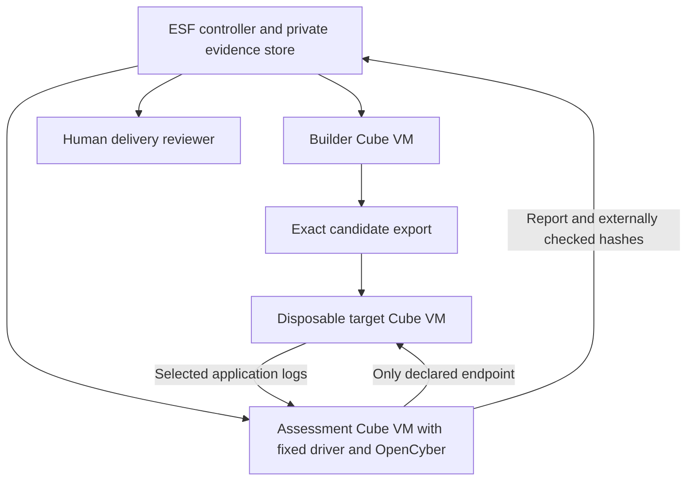
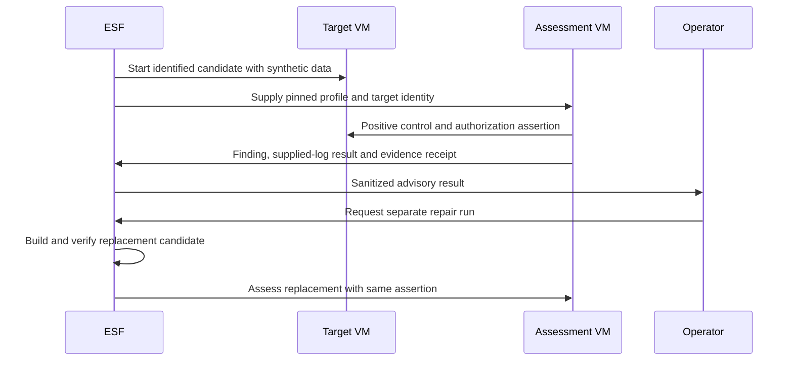
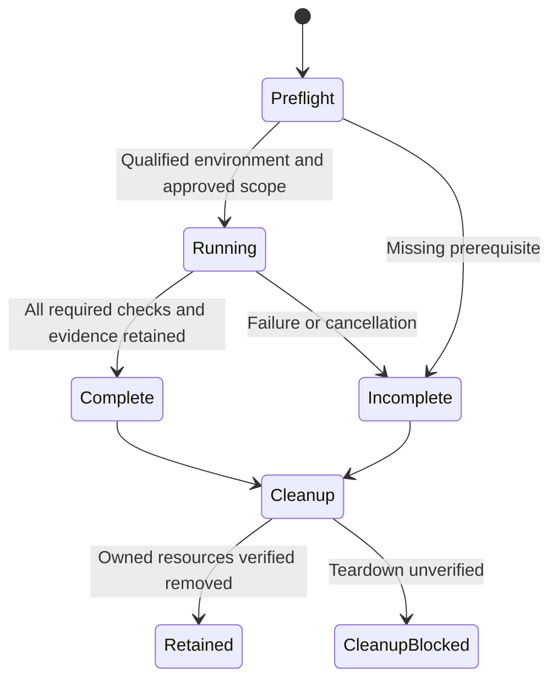
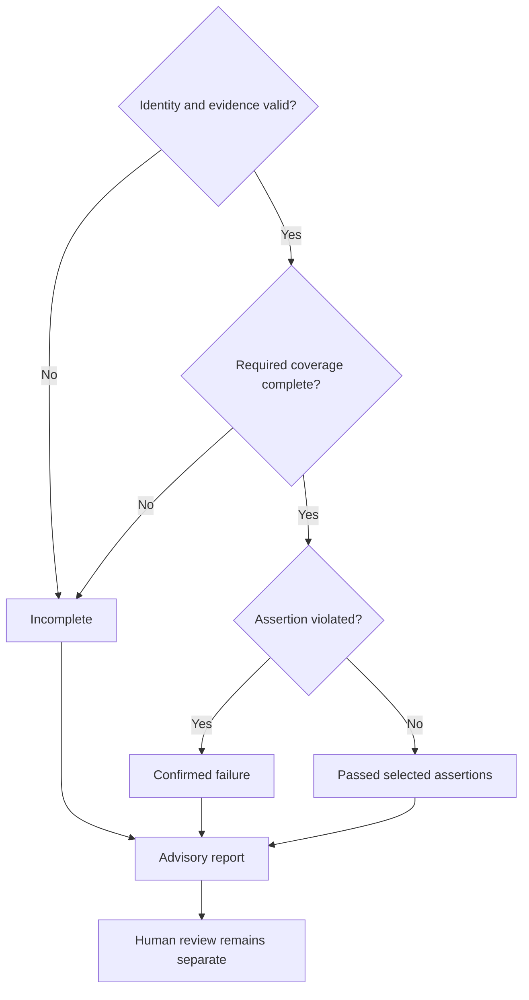
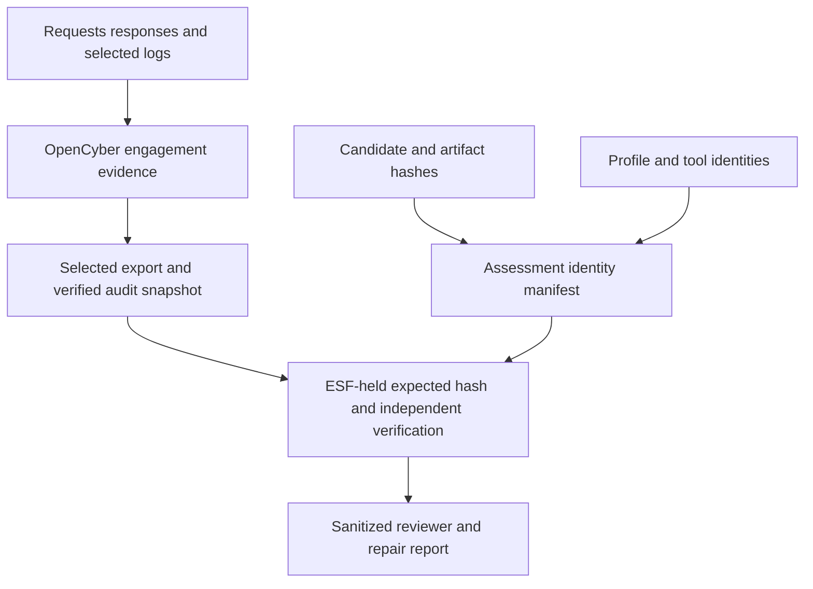

# OpenCyber Factory Assessment - Plan

## Goal Capsule

- **Objective:** Give a delivery reviewer reproducible evidence that a factory-built application satisfies its selected security checks and that a repair closes the demonstrated defect.
- **Recommendation:** **Trial** a narrow, optional integration. Keep ESF as delivery orchestrator and OpenCyber as the assessment backend. Defer autonomous attack/repair loops and mandatory release gating.
- **Means:** A factory-owned assessment adapter and candidate-bound evidence contract, followed by a disposable API pilot (KTD1–KTD6).
- **Authority:** This document authorizes no implementation, target testing, scope expansion, publication or deployment. An implementation request may begin the preparatory units; runtime activation must satisfy the prerequisite gate below. Human risk acceptance and delivery approval remain separate.
- **Execution profile:** Host builds and drives ESF; project code, security tooling and tests execute inside local Cube microVMs. Preserve unrelated changes in the primary checkout.
- **Stop conditions:** Unqualified isolation/template, candidate mismatch, unexpected destination, exhausted limits or missing required evidence stop the applicable assessment and retain an incomplete result.

### Local execution record — 2026-10-27

The subsequent implementation request authorized the bounded synthetic work.
U1's replacement endpoint and pinned native runtime passed their local checks.
U2–U4 were implemented and checked in Cube, including real Temporal cancellation
and old/new history replay. U5 passed three native before/after pairs and a
separate parent-linked factory repair pair; the authorized control and repaired
denial telemetry passed. All owned resources were removed.

The expansion decision remains **optional private trial**: representative
delivery findings, triage effort, marginal cost and human acceptance have not
been established. See the [qualification and integration handoff](../../release/qualification/opencyber-cube-pilot.md)
for exact identities, observed limitations and validation evidence. The
planning-stage evidence statements below retain their original temporal scope.

---

## Product Contract

### Summary

Add an optional assessment of the exact application candidate ESF produces, using selected OpenCyber tools and independently retained evidence.
Start with deterministic API authorization assertions and offline application-log analysis, then repair through a separate operator-requested ESF run and repeat the assertions.
Use the pilot's incremental findings, effort and delay to decide whether deeper integration is justified.

### Problem Frame

ESF already turns a request into a candidate, runs deterministic verification in Cube, collects evidence and supports human review.
Its existing OpenCyber watcher audits ESF's own source for dependency, configuration and secret candidates, with separate OpenCode triage.
It does not establish the security behavior of each application the factory delivers.

The opportunity is to connect a demonstrated application defect to a repair and a repeatable regression check.
Adding more scanner output alone would duplicate existing work and increase triage load.
A generated application can pass its build and functional tests while still exposing another tenant's data or producing insufficient defensive telemetry.

### Current Evidence and Fit

**ESF implementation baseline:** `ba829056ab728b8e002dddcb702edc0be5b19a1d`.
Local validation does not establish deployed behavior or production acceptance.

**OpenCyber baseline:** aligned source, image, rootfs and catalog identities are
recorded in the sanitized qualification report. Full source/export provenance
remains in private operator evidence. An available preview image cannot
substitute for those pins or establish Cube compatibility or distribution clearance.

| Capability | What exists today | Increment from this plan |
|---|---|---|
| Source checks | ESF watcher invokes OpenCyber Trivy for ESF itself | Associate selected product checks with each candidate when useful |
| Application security | ESF fixed verification commands; OpenCyber HTTP/API tools | Reproduce an application authorization defect against a built candidate |
| Remediation | ESF can run another request and record parent/change lineage | Carry sanitized reproduction evidence into repair and verify the replacement |
| Blue-team work | OpenCyber analyzes supplied logs, files and PCAPs | Correlate the pilot request with application logs and check expected telemetry |
| Evidence | ESF manifests; OpenCyber engagement audit and export | Bind both to candidate, assessment request, target and tool identities |
| Approval | ESF supports human review; OpenCyber has separate PoC gates | Keep evidence, security outcome and human acceptance distinguishable |

OpenCyber is a tool substrate, not a red/blue agent or an EDR/SIEM.
The factory must supply the target, test identities, assessment plan and application telemetry.
Its broad hardware, radio and exploitation catalog has little immediate value for a generic software delivery path.

Existing source-watcher results and model configuration remain private and
separate from this application pilot. No model call or scan was run to create
the plan. Optional AI availability must not become an implicit dependency of
every delivery or cause a provider substitution.

### Requirements

**Assessment value**

- R1. Assess a declared application security property beyond the existing source watcher, and preserve a reproducible failing example when the property is violated.
- R2. Show separately what was tested, what failed, what was omitted and what remained unknown; an empty finding list is not sufficient evidence of coverage.
- R3. Link a confirmed finding to a replacement candidate and rerun the original assertion alongside a valid positive control.
- R4. For the blue-team portion, evaluate supplied application evidence against a declared telemetry expectation; absent or partial logs cannot establish successful detection.

**Trust and evidence**

- R5. Bind each assessment to exact candidate bytes, target instance, ESF run/change, profile, request and tool/asset identities.
- R6. Execute assessment and target code within the Cube boundary, with trusted assessment policy/evidence isolated from target writes and with only the declared target endpoint reachable.
- R7. Restrict tool names, arguments, engagement paths and budgets in trusted factory code; target output and model suggestions cannot grant capabilities.
- R8. Preserve separate scanner, reproduction, telemetry and optional AI outcomes, including partial, unavailable and error states.
- R9. Retain verifiable selected evidence and an independently stored expected hash before destroying assessment resources; sanitize ordinary reports and repair context.

**Delivery lifecycle**

- R10. Keep the first integration optional and advisory, with distinct security results rather than changing existing human approval semantics.
- R11. Preserve the configured model/provider and report unavailable AI coverage without substitution; deterministic checks must not require optional AI triage.
- R12. Bound attempts, requests, duration, evidence volume and resource ownership, and reconcile interrupted work before any retry.
- R13. Require a fresh assessment after repair or any material candidate/profile/tool change; lineage alone does not transfer a prior pass or grant repair authority.

### Scope Boundaries

The active plan covers one synthetic HTTP/API application and its supplied logs, a narrow controller-driven assessment, evidence export, advisory factory reporting and an operator-requested repair/retest.
It preserves the current source watcher and its source-only authorization.

#### Deferred to Follow-Up Work

- An opt-in required security gate, after pilot acceptance.
- Automatic repair admission, enforced model-spend budgets and repeated repair attempts.
- Model-selected assessments, broader DAST profiles, PCAP correlation and application-specific authentication matrices.
- CVE-chain/PoC execution, hardware/firmware assessments and deployment security monitoring, each needing its own scope and qualification.

#### Outside the Initial Integration

Production attacks, unrestricted shell/Python/browser access, credential dumping, persistence, radio/device access, automatic risk waivers and agent-controlled release approval.
A published vulnerability count, tool count or audit-chain check will not be represented as production acceptance or standards compliance.

### Acceptance Examples

- AE1. **Covers R1–R4.** With synthetic users A and B, A can read A's resource. A request for B's resource demonstrates the seeded authorization defect and has a unique correlation ID. After repair, the same unauthorized request is denied while A's authorized request still succeeds. The expected denial telemetry is found in the supplied logs.
- AE2. **Covers R2, R8, R11.** A missing tool, unreachable target, capped response, absent log or unavailable model produces the corresponding incomplete coverage; it cannot produce a successful security assertion through lack of output.
- AE3. **Covers R5, R9, R13.** Replacing candidate bytes or the assessment profile invalidates the previous receipt. Verification of the selected exported evidence uses the hash retained by ESF, outside target-writable state.
- AE4. **Covers R7, R10, R12.** Instructions embedded in a target response cannot trigger a new tool or destination. Cancellation tears down only owned resources. An advisory assessment never supplies human approval.

---

## Planning Contract

### Work Tracking

Cube qualification and the dependent PoC integration sequence are tracked in [ESF issue #50](https://github.com/mitkox/esf/issues/50).
The issue's completion gate covers U1 qualification and the integration handoff; the full application-security PoC still requires U2–U5.
Its public description is self-contained and omits private repository data and machine-local configuration.

### Assumptions

These are proposed pilot choices, not user-confirmed product commitments.

- A two-tenant API is representative enough to assess the integration's value. If the delivered workload has no relevant runtime surface, keeping source-only checks is the better default.
- The first pilot remains private, synthetic and manually initiated. Existing source-audit permission does not authorize its network testing.
- Proposed pilot limits are 15 minutes per assessment, 100 target requests, 16 MiB of analyzed log input and zero automatic repair attempts. The operator approves the profile and its limits before runtime activation.
- Expansion requires three repeatable before/after runs, all seeded assertions and positive controls behaving as expected, and evidence/cleanup checks passing. Also measure a small agreed sample of representative deliveries for additional confirmed findings, triage time and added latency before making checks mandatory. Synthetic success alone is insufficient justification.

### Key Technical Decisions

- KTD1. **Keep a thin ESF adapter and separate execution roles.** ESF owns profile selection, policy, lifecycle and the decision record; OpenCyber remains a replaceable stdio MCP backend. The coding agent gets sanitized repair evidence, not unrestricted MCP access. Existing managed OpenCode configuration can reject or overwrite custom MCP configuration (`internal/agentharness/opencode.go`), so attaching the toolkit there is both less reliable and a broader trust boundary. Implements R7, R10.
- KTD2. **Qualify infrastructure, then add a distinct runtime activity.** Qualification must prove an OpenCyber-derived Cube template and an enforced route from a dedicated assessment VM to a separate disposable target VM. The sandbox abstraction has template, command/file transport and preview APIs, but no peer-network/VPC contract. If restricted preview routing cannot qualify, stop runtime work and retain the source-only integration. Once it passes, add a versioned factory-owned activity after ordinary verification and candidate collection, before human review. Existing fixed-argv profiles remain suitable for source-only scans; they cannot own this two-VM lifecycle without hiding resource and failure state in a subprocess. Implements R6, R10, R12.
- KTD3. **Use an explicit assessment manifest.** Record run/change/parent IDs; source-tree and built-artifact digests; profile and request digests; target instance/address and ephemeral identity labels; OpenCyber source/image/catalog identities; scanner versions/assets/database timestamp; invocation IDs and output hashes; coverage/findings; resource ownership and cleanup. Store bounded summaries and artifact references in ESF, with raw sensitive evidence in private storage. OpenCyber envelopes do not themselves bind the request or candidate. Implements R2, R5, R8, R9.
- KTD4. **Export the actual candidate rather than replaying a persisted patch.** Freeze the assessed deliverable and hash its complete input set. Reject unexplained changes between the deliverable, verification and assessment snapshots. ESF's stored patch is redacted, `ResultingSHA` does not identify dirty bytes, and local-path Git transport carries committed objects. An exact bounded export must use sandbox file transport and preserve declared file semantics, with credential/symlink exclusions visible. Implements R5, R13.
- KTD5. **Use a small deterministic tool allowlist.** Initially allow only necessary engagement operations, explicit HTTP/API assertions, selected log-triage reads and audit/evidence export/verification. Deny generic execution dispatch, shell, Python, browser, hardware and PoC tools. Validate every invocation and redirect; enforce network denial independently. Compact/catalog category filters only change discovery, and OpenCyber's scope/offline settings do not replace a firewall. Implements R6–R8. This follows the [MCP tools security guidance](https://modelcontextprotocol.io/specification/2025-11-25/server/tools) and [OWASP MCP guidance](https://cheatsheetseries.owasp.org/cheatsheets/MCP_Security_Cheat_Sheet.html).
- KTD6. **Use existing evidence export and an explicit repair handoff.** Export selected OpenCyber evidence and verify it against the ESF-held hash. Prepare a sanitized finding/reproduction packet for a separate operator-requested run using existing Change/ParentRun lineage. Repeat normal verification and the same assessment on the replacement. No automatic repair loop is needed to establish R3. OpenCyber's timeline tools parse evidence; the adapter must judge the declared telemetry assertion. Implements R3, R4, R9, R13.

### High-Level Technical Design

The diagrams describe the proposed pilot; template and route readiness remain subject to KTD2.

**Execution boundaries**

**Assessment and repair sequence**

**Assessment lifecycle**

A complete assessment can contain confirmed failures; coverage completion and security outcome are different fields.

**Result decisions**

**Evidence flow**

### Infrastructure Gate and Deferred Prerequisites

Preparatory implementation can start with U1. **Runtime activation is blocked until U1 proves the template and endpoint route.**
The current Cube deployment image carries agent prerequisites, not a qualified OpenCyber runtime.
Do not assume nested Docker, direct VM addressing, a public preview, or reuse of the existing host watcher container.

Use a reviewed source/runtime pin and qualify the exact selected tool/catalog behavior.
The private preview is available for investigation, but its frozen runtime revision differs from canonical main.
A narrow development template can be qualified for this private profile without claiming the full toolkit is production-qualified.
Any distribution of derived images remains outside this plan and retains the repository's vendor/license follow-ups.

For U4's new Temporal activity, follow the existing `workflow.GetVersion` pattern and replay old histories.
SDK `v1.49.0` remains pinned; do not introduce deprecated legacy Build-ID worker versioning.
Security side effects belong in activities with explicit retry/idempotency decisions, not in deterministic workflow code. See [Temporal Go versioning](https://docs.temporal.io/develop/go/workflows/versioning) and [retry policies](https://docs.temporal.io/encyclopedia/retry-policies).

### Alternatives and Decision Economics

| Approach | Fit | Decision |
|---|---|---|
| Keep the existing source watcher | Lowest cost; sufficient for dependency/configuration/secret needs | Valid fallback if runtime value is absent |
| Add a narrow candidate assessment adapter | Reuses tools/evidence and factory lifecycle patterns; measures application behavior | Trial |
| Run a conventional dedicated application scanner | Simpler where one stable scanner covers the whole need | Prefer if OpenCyber's evidence and multi-tool reuse add no measured benefit |
| Give the coding agent all OpenCyber tools | Config conflicts, weak independence and excessive capability | Reject as the initial integration |
| Merge orchestrators or launch autonomous attack/repair teams | Requires new targets, budgets, admission and approval boundaries | Hold pending demonstrated need |

No competing mechanism needs a prototype to resolve this initial choice: existing lifecycle patterns and source boundaries support the adapter trial.
The unresolved question is runtime qualification, which U1 deliberately tests before dependent work.

Expansion is justified only if confirmed application findings, checked repairs or useful telemetry evidence repay template maintenance, runtime delay, model/compute cost and reviewer effort.
If the need is merely Trivy-on-every-build, a fixed verifier is sufficient and a deeper red/blue integration should not be built.

---

## Implementation Units

### U1. Qualify a minimal Cube assessment environment

**Goal:** Establish whether the proposed private runtime pilot can execute with the required isolation.

**Requirements:** R6, R7, R12; prerequisite for runtime activation. **Dependencies:** none.

**Files:** proposed `deploy/cube/Dockerfile.security`, `deploy/cube/README.security.md`, `release/qualification/opencyber-cube-pilot.md`; extend provider tests only if a provider change proves necessary.

**Approach:** Inspect current template build/import and preview routing. Build a minimal pinned OpenCyber userspace template with the selected profile's dependencies, not every optional toolkit capability. Qualify two owned disposable VMs and the restricted endpoint route under KTD2; record a blocking result if the route or resource requirements cannot be satisfied.

**Patterns:** `deploy/cube/Dockerfile`, `internal/sandbox/cube/provider.go`, `deploy/cube/README.security.md`.

**Execution note:** Prefer template startup, endpoint and cleanup proof before implementing the integration. This unit does not activate tests against any real application.

**Test scenarios:**

1. Required OpenCyber version/catalog/tools load in the selected template with recorded resource use.
2. Assessor reaches the synthetic target as a positive control; other destinations and ports, redirects and host/metadata addresses remain denied.
3. Target cannot write assessor policy/evidence or access management credentials.
4. Timeout and cancellation leave no owned sandbox, route or process running; the existing source-watcher container remains independent.

**Verification:** Retained template/route qualification evidence with exact pins and owned cleanup, or an explicit stop decision. A failed gate prevents U3 runtime work.

### U2. Define assessment identity and exact candidate transfer

**Goal:** Make the evidence unambiguously refer to the delivered candidate.

**Requirements:** R2, R5, R8, R9, R13. **Dependencies:** none; runtime validation waits for U1.

**Files:** proposed `internal/securityassessment/profile.go`, `result.go`, `candidate.go`, `profile_test.go`, `result_test.go`, `candidate_test.go`; extend `internal/factory/activities.go`, `model.go`, `evidence_test.go` only where candidate export and artifact references require it.

**Approach:** Implement KTD3–KTD4 using the existing sandbox file transport. Keep raw source export ephemeral and private; persist a sanitized manifest and selected evidence references. Define independent coverage, assertion and cleanup outcomes. Reuse watcher sanitization patterns without importing its daily-cache policy.

**Patterns:** `internal/repository/provider.go`, `scripts/esf-security-watch.py`, existing factory evidence persistence.

**Test scenarios:**

1. Dirty/untracked candidate content is represented by file digests rather than HEAD alone; a redacted patch cannot substitute for export.
2. Verification changes candidate bytes unexpectedly, or input exceeds declared limits: qualification is incomplete rather than silently excluding content.
3. Credential exclusions and detected-secret withholding are visible; source and cookie canaries do not enter ordinary reports or repair context.
4. Wrong run/candidate/profile/catalog/request identity, unsupported schema and malformed results are rejected.
5. Missing or modified evidence fails verification against the factory-held expected hash.

**Verification:** Exact-candidate transfer and identity/error tests pass in Cube on the implementation candidate.

### U3. Add the fixed OpenCyber assessment driver

**Goal:** Execute the selected assertions and collect trustworthy bounded evidence.

**Requirements:** R1, R2, R4, R6–R9, R11, R12. **Dependencies:** U1 passes, U2.

**Files:** proposed `internal/securityassessment/opencyber.go`, `runner.go`, `opencyber_test.go`, `runner_test.go`; proposed `tools/security-assessment/` driver entrypoint and focused tests if packaging outside the Go library is required.

**Approach:** Apply KTD1 and KTD5 through a fixed driver rather than a general-purpose broker service. Create or reconcile the attempt engagement, run declared HTTP assertions, analyze copied logs, export selected evidence and produce the manifest. Freeze ephemeral target credentials outside AI context. Optional triage consumes sanitized results only.

**Patterns:** Existing watcher stdio JSON-RPC framing; canonical OpenCyber `src/opencyber/server.py`, `contracts.py`, `envelope.py`, `evidence.py` and their tests. These OpenCyber paths are relative to the named repository.

**Test scenarios:**

1. Allowlisted calls succeed for the owned engagement; alternate tools, generic dispatch, cross-engagement paths and unexpected arguments are refused before execution.
2. Target text containing instructions cannot change the profile, destination, approval or next tool call.
3. Tool-specific finding exits are distinguished from tool failure; partial/unknown coverage and stale required assets remain incomplete.
4. Missing logs and a missing correlation event remain unobserved; a complete file hash does not override partial content analysis.
5. Unknown acknowledgement, retry, cancellation and limit exhaustion reconcile the recorded attempt without duplicating live requests; unsafe retries are disabled.
6. Model failure preserves deterministic evidence and the configured provider without making optional triage a pass requirement.

**Verification:** Fake-transport contract tests and real pinned-backend tests in Cube establish the selected profile, without claiming coverage of the full catalog.

### U4. Add a versioned advisory assessment stage and reporting

**Goal:** Let an operator request and inspect the pilot through the existing factory path.

**Requirements:** R5, R8–R10, R12. **Dependencies:** U2, U3.

**Files:** extend `internal/factory/config.go`, `resources.go`, `model.go`, `workflow.go`, `worker.go`, `evidence_test.go`, `review_workflow_test.go`; proposed `internal/factory/activities_security.go`, `security_assessment_test.go`; update `internal/factory/example.toml`, `docs/continuous-security.md` and proposed `docs/security-assessment.md`.

**Approach:** Resolve an operator-owned assessment profile and add the versioned post-verification activity per KTD2. Keep allocation, reconciliation, candidate transfer and teardown in factory activities, so no assessor or target receives Cube management credentials. Record an advisory security report as a distinct artifact and summary before human review. Keep the source watcher separate and leave existing mandatory functional gates authoritative.

**Patterns:** Existing `workflow.GetVersion` branches, activity retry policies, artifact-error handling and owned cleanup, `internal/factory/review_workflow_test.go`.

**Test scenarios:**

1. Disabled integration and old execution histories preserve their prior command path; an enabled advisory report cannot hide a failed mandatory functional gate or quarantine.
2. Partial/failed assessment appears in retained artifacts before review and does not become human approval or a security pass.
3. Review timeout/rejection keeps its current semantics and preserves distinct assessment evidence.
4. Artifact persistence failure and target cleanup failure are visible and prevent a complete security receipt.
5. Repeated/cancelled execution removes only owned pilot VMs and routes, including failures before all resource IDs are returned.
6. Replay pre-change histories and new enabled/disabled histories with the versioned branch; all network, model and filesystem effects remain outside workflow code.

**Verification:** An exact-candidate factory run retains the report, ordinary verification results, review outcome and cleanup separately. Existing workflow histories remain replay-compatible.

### U5. Demonstrate repair and decide whether to expand

**Goal:** Establish incremental value using a reproducible application defect and a checked repair.

**Requirements:** R1–R4, R10, R13; AE1–AE4. **Dependencies:** U4.

**Files:** proposed `testdata/security-assessment/tenant-api/`, including a fixture assertion suite; `internal/securityassessment/pilot_test.go`; `release/qualification/opencyber-pilot.md`; `docs/security-assessment.md`.

**Approach:** Use KTD6 for the synthetic before/after exercise. Record the defect, distinct request IDs, selected logs, sanitized repair packet, parent/new run lineage and replacement evidence. Keep repair initiation manual. Evaluate the proposed acceptance and economic thresholds in Assumptions before recommending a required gate.

**Test scenarios:**

1. Covers AE1. The vulnerable candidate violates tenant isolation while the authorized control succeeds; the repair denies the violating request and keeps the control working.
2. Covers AE2. A stopped target, invalid credential, absent log and capped analysis each fail to demonstrate repair or detection.
3. Covers AE3. Replacement bytes invalidate the old receipt; exported evidence verifies independently before teardown.
4. Covers AE4. Target-provided instructions cannot widen scope; cancellation and advisory reporting preserve separate human approval.
5. Repeated trials produce the same assertions and leave no owned resources; a no-finding representative run records coverage and cost rather than inferring universal security.

**Verification:** A reviewer can trace the defect and repair from retained hashes, requests and logs, and assess measured benefit versus the simpler source-only or dedicated-scanner alternatives.

---

## Verification Contract

No implementation, build, scan or runtime test was performed to create this plan.
Review and source inspection are planning evidence only.

| Scope | Verification during implementation | Evidence required |
|---|---|---|
| ESF build | Host `make build` | Candidate identity and build result |
| New Go behavior | Focused `go test` for `internal/securityassessment`, `internal/verification`, affected `internal/factory` tests inside Cube | Exact source snapshot, actual test names/results and toolchain |
| Template/backend | U1 startup plus strict catalog/required-tool checks inside assessment Cube | Template/image/source/catalog and asset identities |
| Integration | U3–U5 disposable API, evidence and failure-path checks inside Cube | Requests, positive controls, coverage and external hashes |
| Factory plumbing | Existing conformance demo, when affected | Separate fixture-only result |
| Review and cleanup | Independent scoped review plus `factory sandboxes` reconciliation | Findings disposition and zero owned resources |

Read actual local factory configuration at implementation time. Do not restore template IDs from old notes.
A run using only committed Git transport cannot validate unrelated dirty host bytes.
Full application qualification, matching-head CI, human approval, merge, deployment and live customer acceptance remain separate outcomes.

[NIST SSDF PW.8 and RV.2–RV.3](https://nvlpubs.nist.gov/nistpubs/SpecialPublications/NIST.SP.800-218.pdf) support the executable-test and remediation direction.
Use [OWASP ASVS 5.0.0](https://asvs.owasp.org/) and [WSTG authorization testing](https://github.com/OWASP/www-project-web-security-testing-guide/blob/master/stable/4-Web_Application_Security_Testing/05-Authorization_Testing/02-Testing_for_Bypassing_Authorization_Schema.md) to select explicit assertions; mapping a tested subset is not an ASVS compliance claim.

---

## Definition of Done

The private pilot is complete when U1–U5 provide the agreed before/after evidence, meaningful failure cases, bounded resource use and independently reviewed results.
A failed infrastructure gate is a valid trial outcome and leaves runtime integration blocked rather than prompting a weaker host-execution fallback.

The handoff must distinguish implemented behavior, Cube proof, unresolved coverage, reviewer findings and remaining human decisions.
Remove abandoned experiments and retain only the selected driver, fixtures, documentation and private evidence references.

Expansion remains a separate decision. Choose **Adopt** for a specific qualified application profile only after it proves useful; choose **Hold** or retain source-only checks if maintenance, noise or delivery delay exceeds the demonstrated benefit.
